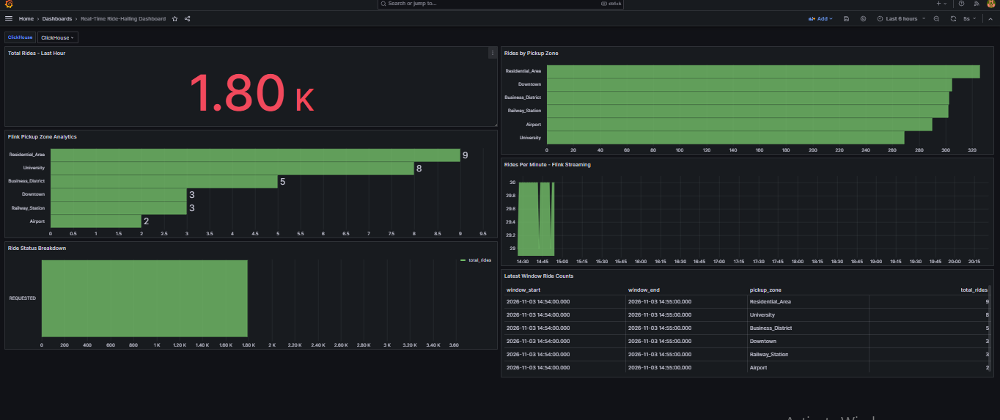

# Real-Time Ride-Hailing Data Engineering Pipeline

A real-time data engineering project that simulates ride-hailing events, streams them through Apache Kafka, processes them using Apache Flink, stores raw and aggregated data in ClickHouse, and visualizes live analytics through Grafana.

## Project Overview

This project demonstrates an end-to-end real-time data engineering pipeline for a ride-hailing platform.

The system continuously generates ride events and processes them through a distributed streaming architecture. It stores raw ride events and real-time aggregated metrics for analytical reporting.

## Business Problem

Ride-hailing platforms generate continuous streams of operational data, including ride requests, pickup locations, and event timestamps.

This project demonstrates how such data can be processed in near real time to monitor:
- Total rides
- Ride distribution across pickup zones
- Time-based ride activity
- Aggregated operational metrics

## Architecture

```text
Python Ride Simulator
        |
        v
   Apache Kafka
   (ride-events)
        |
        +---------------------------+
        |                           |
        v                           v
 Python Raw Consumer           Apache Flink
        |                      Event Time
        v                      Watermarks
   ClickHouse                      |
   Raw Events                       v
                              Kafka Metrics
                                   |
                                   v
                           Python Metrics Consumer
                                   |
                                   v
                              ClickHouse
                           Aggregated Metrics
                                   |
                                   v
                                 Grafana
                             Live Dashboard
```

## Technology Stack

| Technology | Purpose |
|---|---|
| Python | Event generation and Kafka consumers |
| Apache Kafka | Real-time event streaming |
| Apache Flink | Stream processing and window aggregations |
| ClickHouse | Analytical data storage |
| Grafana | Real-time visualization |
| Docker | Containerized infrastructure |
| SQL | Data querying and analytics |
| Git & GitHub | Version control |

## Data Flow

1. Python generates simulated ride events.
2. Events are published to the Kafka `ride-events` topic.
3. A Python consumer reads raw events and stores them in ClickHouse.
4. Apache Flink consumes ride events and performs event-time processing with watermarks.
5. Flink calculates one-minute ride aggregations by pickup zone.
6. Aggregated metrics are published to Kafka.
7. A Python metrics consumer stores the aggregated results in ClickHouse.
8. Grafana queries ClickHouse and displays live analytics.

## Project Structure

```text
real-time-ride-hailing-data-pipeline/
│
├── src/
│   ├── simulator/
│   │   └── ride_simulator.py
│   │
│   └── processing/
│       ├── kafka_to_clickhouse.py
│       └── flink_metrics_to_clickhouse.py
│
├── data/
├── docs/
├── tests/
├── .gitignore
└── README.md
```

## Key Features

- Continuous ride-event simulation
- Kafka-based real-time streaming
- Flink event-time processing
- Watermark-based event handling
- One-minute window aggregations
- Pickup-zone analytics
- ClickHouse analytical storage
- Grafana real-time dashboard

## Grafana Real-Time Dashboard

The project includes a Grafana dashboard connected to ClickHouse for real-time ride-hailing analytics.

The dashboard visualizes ride activity, pickup-zone distribution, and Flink streaming analytics.


## Project Status

The end-to-end streaming pipeline has been implemented and functionally tested.

The simulator, Kafka consumers, Flink processing job, ClickHouse storage, and Grafana dashboard have been integrated.

Additional documentation, automated tests, and performance measurements will be added as the project develops.

## Future Improvements

- Add automated unit and integration tests.
- Add data quality validation.
- Implement structured logging and error handling.
- Add Docker Compose deployment instructions.
- Measure processing latency and throughput.
- Add monitoring and alerting.

## Author

**Furqaan**

GitHub: https://github.com/furqaan123456